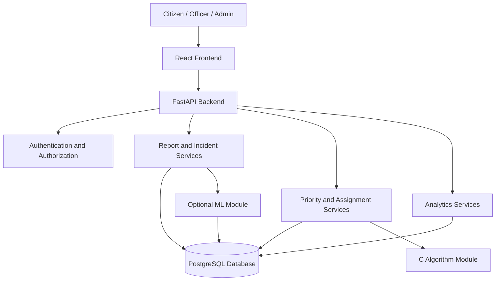

# System Architecture

## 1. Overview

Civic Infrastructure Intelligence follows a modular full-stack architecture. The frontend handles user interaction, the backend implements application rules, the database stores persistent information, and a dedicated C algorithm module provides selected data-structure and graph-algorithm functionality.

Python will be used for the API, business logic, data processing, and optional machine learning. C will be used for selected algorithm implementations. React will provide the web interface.

## 2. Technology Stack

| Component | Technology | Responsibility |
|---|---|---|
| Frontend | React, JavaScript, HTML, CSS | User interface and interaction |
| Routing | React Router | Navigation between pages |
| Backend API | Python, FastAPI | Request handling and application logic |
| Database | PostgreSQL | Persistent application data |
| Database access | SQLAlchemy and/or SQL migrations | Database operations and schema management |
| Authentication | Secure password hashing and token/session-based authentication | Identity and access control |
| Maps | Leaflet, OpenStreetMap | Incident location visualization |
| Charts | Recharts or Chart.js | Analytics dashboards |
| Algorithms | C | Priority queue, graph traversal, shortest-path algorithms |
| Data analysis | Python, pandas, NumPy | Data preparation and evaluation |
| Optional ML | scikit-learn | Selected predictive or classification tasks |
| Testing | pytest and frontend testing tools | Automated quality checks |
| Version control | Git and GitHub | Collaboration and change history |

The stack may be adjusted during implementation if a simpler option meets the requirements.

## 3. High-Level Architecture



The frontend communicates with the backend through HTTP API requests. The backend validates requests, applies authorization, executes business rules, and accesses PostgreSQL. The algorithm module provides selected computational operations to the backend. Optional ML functionality will be isolated so that the main application works without it.

## 4. Component Responsibilities

### 4.1 Frontend

The React application will provide:

- Registration and login screens.
- Citizen reporting forms.
- A list of submitted reports.
- Incident details and status history.
- Map-based incident exploration.
- Officer dashboards for assignment and status updates.
- Administrator dashboards for analytics and management.

The frontend will perform basic input validation for usability. The backend will remain responsible for authoritative validation and authorization.

### 4.2 Backend API

FastAPI will expose endpoints for authentication, reports, incidents, teams, assignments, and analytics.

Backend services will contain the main application rules, including:

- Report validation and persistence.
- Incident matching and aggregation.
- Priority-score calculation.
- Department recommendations.
- Repair-team suitability and allocation.
- Status transitions and audit history.
- Analytics aggregation.

Business rules should live in service modules rather than being duplicated across API routes.

### 4.3 Database

PostgreSQL will store users, reports, incidents, departments, teams, assignments, status history, and feedback.

A report will represent an individual citizen submission. An incident will represent the underlying infrastructure problem. The relationship between reports and incidents will preserve the original submissions while allowing multiple reports to support one incident.

### 4.4 C Algorithm Module

The C module will implement selected algorithms that can be tested independently.

Initial candidates:

- A binary heap or priority queue for ordering incidents.
- Graph representation for the road or travel network.
- Dijkstra's algorithm for shortest paths when edge weights are non-negative.
- A simple greedy team-allocation heuristic.

The Python backend may invoke compiled C functions through a small shared library using `ctypes`, or through a subprocess with a defined input/output format. The integration method will be selected after the standalone C algorithms work correctly.

C will not handle authentication, web requests, or direct database access in the initial architecture.

### 4.5 Optional Machine-Learning Module

Machine learning is an extension rather than a dependency of the core application.

Possible experiments include:

- Text-based report category classification.
- Estimation of resolution duration from historical examples.
- Prediction of recurring issue risk.

Each model must have an appropriate dataset, evaluation procedure, and documented limitations. Rule-based logic will remain the baseline.

## 5. Core Data Flow

### 5.1 Report Submission

1. A citizen fills in the report form.
2. The frontend sends the report to the backend.
3. The backend validates the input and checks authorization.
4. The report and its metadata are saved in PostgreSQL.
5. The system searches for potentially related incidents.
6. The report is linked to an existing incident or placed into a review/new-incident workflow.
7. The citizen receives the resulting report identifier and current status.

### 5.2 Prioritization

1. The incident service retrieves relevant incident information.
2. The priority engine calculates a score from configured factors.
3. The score and its contributing factors are stored or reproducibly calculated.
4. The officer dashboard orders incidents using priority and applicable tie-breaking rules.
5. An authorized officer can review and override recommendations where appropriate, with the action recorded.

### 5.3 Assignment

1. The system identifies the responsible department.
2. It filters teams by required skills and availability.
3. It evaluates suitability using priority, workload, and distance.
4. The allocation engine recommends a team.
5. An authorized officer confirms or changes the assignment.
6. The assignment and subsequent status changes are recorded.

### 5.4 Resolution Verification

1. An officer records the proposed resolution.
2. The officer submits repair notes and supporting evidence.
3. The incident enters a resolved or awaiting-verification state.
4. Citizen feedback or an authorized review can flag an unresolved issue.
5. Reopened incidents retain their history and contribute to recurrence analytics.

## 6. Suggested Backend Structure

```text
backend/
  app/
    main.py
    api/
      auth.py
      reports.py
      incidents.py
      teams.py
      assignments.py
      analytics.py
    models/
    schemas/
    services/
      duplicate_detection.py
      priority_engine.py
      department_router.py
      assignment_engine.py
      analytics.py
    database/
      connection.py
    core/
      config.py
      security.py
    ml/
  tests/
  requirements.txt
```

## 7. Suggested Frontend Structure

```text
frontend/
  src/
    components/
    pages/
      Login.jsx
      Register.jsx
      CitizenDashboard.jsx
      ReportIssue.jsx
      IncidentDetails.jsx
      OfficerDashboard.jsx
      AdminDashboard.jsx
    services/
      api.js
    hooks/
    layouts/
    routes/
    App.jsx
    main.jsx
```

The folder structure may evolve as implementation progresses.

## 8. Error Handling and Security

- Validate all incoming data on the backend.
- Use parameterized database operations or a suitable ORM.
- Keep secrets in environment variables.
- Enforce role-based access on protected endpoints.
- Restrict uploaded file types and sizes.
- Avoid exposing private citizen information on public maps.
- Record important assignment and status changes.
- Handle algorithm failures without crashing the entire API.
- Do not treat duplicate matching or ML predictions as infallible.

## 9. Deployment Approach

The first milestone is a working local development environment. After the application and database work reliably, the project can be containerized and deployed to suitable hosting services.

Deployment choices must account for free-tier limitations, database persistence, file storage, secrets, and map-provider terms.

## 10. Architecture Evolution

The project will start as a modular application rather than a collection of microservices. Components can be separated later if demonstrated performance, maintenance, or deployment requirements justify that complexity.
